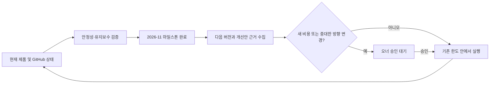

# DevHotel 제품 수명주기 계획

## 제품과 운영 기준

DevHotel은 Windows 11용 격리 개발 런타임이다. canonical checkout은 `C:\_Project\DevHotel`이며, 현재 버전은 `0.5.4`, 제품 단계는 released다. 제품의 실제 상태와 우선순위는 GitHub issue, PR, milestone 및 최신 계획 감사에서 확인한다. 이 계획은 의사결정 기준을 기록하며 GitHub 작업 원장을 대체하지 않는다.

## 현재 마일스톤: 2026-11

목표는 Windows 11 격리 런타임의 안정성 및 유지보수를 검증하고 현재 등록된 작업을 마무리하는 것이다. 2026-11 마일스톤은 2026-11-30 종료 예정이며, 읽기 전용 운영 스냅샷 기준 열린 이슈 1개 중 완료 0개다. 현재 확인된 작업은 #175 PLC 정본 기록이다. 다른 후속 일감이나 PR은 확인되지 않았으므로 임의로 만들어 기록하지 않는다.

## 실행 순서

1. 최신 계획 감사 결과와 GitHub 상태를 확인하고, 승인된 버그·안정성·유지보수·마일스톤 작업을 실행한다.
2. 기존 동작을 검증한다. 호스트 입력 격리, Room 경계, 소유권 및 실패 시 안전 동작을 보존하고 실제 실행 근거와 제약을 남긴다.
3. 빈 대기열에서도 다음 판단에 필요한 사실을 확인한다. 열린 이슈, 마일스톤, 현재 버전, 배포 설정과 검증되지 않은 수용 조건을 근거로 우선순위를 정한다.
4. 검증된 유지보수와 작은 개선은 기존 운영 한도 안에서 진행한다. 새로운 기능이나 중대한 제품 방향 변경은 `needsApproval: true`, `reason: direction`으로 제안하고 오너 승인을 기다린다.
5. 새 유료 자원 또는 유료 API가 필요한 작업은 `needsApproval: true`, `reason: cost`로 제안하고 승인 전에는 지출하지 않는다. 기존 구독 AI는 공유 자원 관리자 라우팅과 한도를 따른다.
6. 변경은 로컬 검증과 PR/CI 검토를 거친다. 배포 설정은 `not_required`이므로 release/deploy/image publication workflow, 태그 및 릴리스는 실행하지 않는다.

## 수명주기 전환

## 완료 및 갱신 기준

- 이슈는 구현 범위와 수용 조건을 충족하고 실제 로컬/CI 검증 결과가 남아야 완료로 본다.
- milestone 대상은 해당 GitHub milestone과 필수 CI 결과를 확인한다. 배포가 요구되지 않는 동안 production 배포를 만들지 않는다.
- 계획에는 확인된 milestone, 버전, 진행 작업 및 미검증 제한만 갱신한다. 운영 스냅샷의 누락된 로그, heartbeat, 링크별 카운터는 추정하지 않고 알 수 없음으로 취급한다.
- 다음 milestone이 정해지거나 버전/배포 정책/제품 방향이 승인되면 이 문서를 갱신한다. 과거 계획이나 세션 기록보다 현재 GitHub 및 canonical checkout 근거를 우선한다.

## 근거와 범위

작성 기준은 이슈 #175의 목표/기대값/비용 경계, `.loop/project.md`, 현재 `AGENTS.md`, 그리고 `C:\_Project\LoopOffice2\.data\status-export.json`의 DevHotel 항목이다. 스냅샷은 2026-11 milestone `#3` (열린 이슈 1, 완료 0), 버전 `0.5.4`, 제품 단계 `released`를 측정값으로 제공한다. 스냅샷에 기록되지 않은 상세 이슈 목록, PR, 운영 heartbeat 및 개별 리소스 지표는 이 계획에서 주장하지 않는다.
